# 🎨 아트·에셋 모듈

**담당 코드:** 지금 `src/scenes/rift/draw/`(그리는 대상별 파일 = 그림 갈아 끼울 자리), `src/scenes/shared/vfx.ts`(이펙트·멈칫·흔들림), `src/scenes/shared/sfx.ts`(합성 효과음), `src/data/feel.data.ts`(색·타격감 숫자) / 예정 `src/scenes/shared/postfx.ts`(색보정·조명), `assets/`(그림 파일)

## ✅ 결정: 스타일
- **코지 픽셀아트 바탕 + 시티팝 무드를 효과로 덧씌우기.**
- 기본 그림은 단순·따뜻하게. 시티팝은 코드로: 노을 보라·주황 그라데이션, 네온 번짐, 비 반사, 필름 노이즈 (Phaser 화면 효과).
- 같은 골목이 낮엔 코지, 밤엔 시티팝으로 보임.

## ✅ 결정: 1인 개발 에셋 부담을 "구조로" 줄이기
| 원칙 | 줄어드는 작업 |
|------|-------------|
| 귀신 = 그림자·글리치·파티클 이펙트 | 적 걷기 애니메이션 거의 0 |
| 색 바꾸기(팔레트 스왑)로 변종 | 귀신 그림 1장 → 3종 |
| 방은 조립식, 구역당 타일셋 1개 | 의뢰마다 새 맵 안 그림 |
| 분위기는 코드 담당 | 그림이 단순해도 됨 |
| 스토리는 대화창 + 초상화(감정 2~3개) | 컷신 0 |
| 허브는 한 화면 | 넓은 마을 안 만듦 |
| 캐릭터 16~24px | 애니메이션 프레임 부담 감소 |
| **재미 먼저, 그림 나중** | Gate 1~2는 네모·임시 그림. 통과한 것만 그림 |

## 🤔 남은 것
- 픽셀 크기(16px vs 24px) 확정, 팔레트 확정, 아래 아트 시험의 그림 구하는 방법 선택.

## ✅ 다음 단계: 한 층짜리 아트 시험(버티컬 슬라이스) — 2026-10-25
손맛을 가설로 통과시켰으니, 콘텐츠를 늘리기 전에 "그림이 들어가도 손맛이 유지되는지, 이 그림체가 맞는지"를 층 하나로 싸게 확인한다. 이 시험에서 어긋나면 그림 방향을 바꾸고, 맞으면 같은 규격으로 나머지를 채운다.

코드는 이미 그림을 갈아 끼울 자리로 나뉘어 있다: `src/scenes/rift/draw/`에 그리는 대상마다 파일이 하나씩 있고(바닥·벽 `tiles.ts`, 사무소장과 칼 `director.ts`, 괴이 `ghosts.ts`, 계단·공중전화·영력 `props.ts`, 바닥 예고 `telegraph.ts`), 지금은 도형으로 그린다. 그림이 오면 그 파일 하나만 "도형 → 그림 파일"로 바꾸고 나머지는 그대로 둔다. 바닥 예고는 읽기 쉬워야 해서 그림으로 바꾸지 않고 도형+효과로 유지한다.

시험에 필요한 최소 목록(16px 타일 기준, 캐릭터는 한 칸보다 조금 큼):
| 대상 | 크기 | 장면(프레임) |
|------|------|-------------|
| 사무소장 몸 | 약 16×24px | 서 있기 2, 걷기 4 (좌우는 뒤집어서, 위·아래 두 방향) |
| 신문지 사인검 / 드러난 검 | 약 4×14px | 각 1장 (휘두르기는 코드가 돌려서 그림) |
| 처녀귀신(강적 대표) | 약 16×24px | 떠 있기 2, 공격 직전 1 (걷기 없음: 떠다니는 건 코드가 처리) |
| 도깨비불(잡몹) | 약 10×12px | 일렁임 3 |
| 바닥·벽 타일셋 | 16×16px | 바닥 2~3종, 벽 윗면, 벽 앞면 (인쇄소 지하 느낌) |
| 소품 | 16px 안팎 | 계단, 공중전화, 영력 조각 |
| 효과음 | — | 베기, 맞힘, 처치, 발도, 받아치기, 돌진, 피격 (지금은 합성음) |

구하는 방법은 셋 중 하나를 고른다: ① 유료 에셋 팩(가장 빠름, 대신 서울 느낌이 약함 → 타일셋만 팩, 인물은 직접), ② 외주 1회(이 목록 그대로 견적), ③ 직접 또는 AI 보조로 그린 뒤 다듬기. 팔레트는 지금 `feel.data.ts`의 보라·청록 계열을 출발점으로 한다.

## 🧪 견본 1차 (2026-10-25) — 방향: 소울나이트·러스티의 은퇴 같은 큼직한 도트
사용자 기준: 고전 포켓몬처럼 오밀조밀한 도트(LimeZu 같은 팩)는 아님. 칸 안 정보를 적게, 굵은 외곽선, 2등신. 팩을 고쳐 쓰는 대신 우리 것을 적게 직접 만든다.

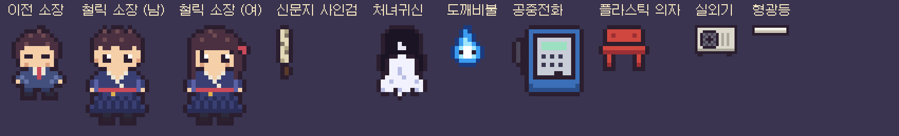

만든 방법: 그림을 코드 안 글자 격자로 적어서 뽑음(`tools/artlab/`). 그래서 외곽선 색·팔레트·크기 규칙이 항상 지켜지고, "머리카락 한 줄 길게" 같은 말로 고칠 수 있다. 지피티는 콘셉트 시안용.

견본에 쓴 규칙(초안): 16px 칸, 인물 14×18 안팎 2등신, 외곽선 1px 진한 갈보라(#2b1e2f, 순검정 아님), 재질당 2~3색, 안티에일리어싱·그라데이션 없음.

서울 분위기를 내는 세 장치:
- 한글 픽셀 폰트 간판(갈무리, 무료 OFL)으로 아무 문구나 코드로 찍기 — 을지인쇄, 24시, 해장국, 노래방…
- 칸 단위로 끊기는 밤 조명 — 형광등 흰빛, 네온 분홍·청록, 도깨비불 파랑, 나트륨 주황
- 반복 소품 — 초록 방수 페인트 벽, 노출 배관, 붙은 전단지, 빨간 플라스틱 의자, 실외기, 공중전화, 바닥에 흩어진 인쇄물

사용자 피드백(1차): 도트 크기·조명 OK. 소장만 키를 조금 키우고 밀도를 살짝 높이기. 소장은 성별 미정의 청년, 철릭을 코트처럼 개조한 옷(서울 판타지), 졸린 눈일 필요 없음.

## 🧪 견본 2차: 철릭 소장 (남/여)
키 18→24px(머리 큰 비율은 유지), 앞이 겹쳐 여미는 깃과 흰 동정, 붉은 허리띠와 금색 매듭, 아래 주름 자락, 넓은 소매. 남자는 짧고 뻗친 머리, 여자는 긴 머리에 붉은 댕기와 속눈썹.

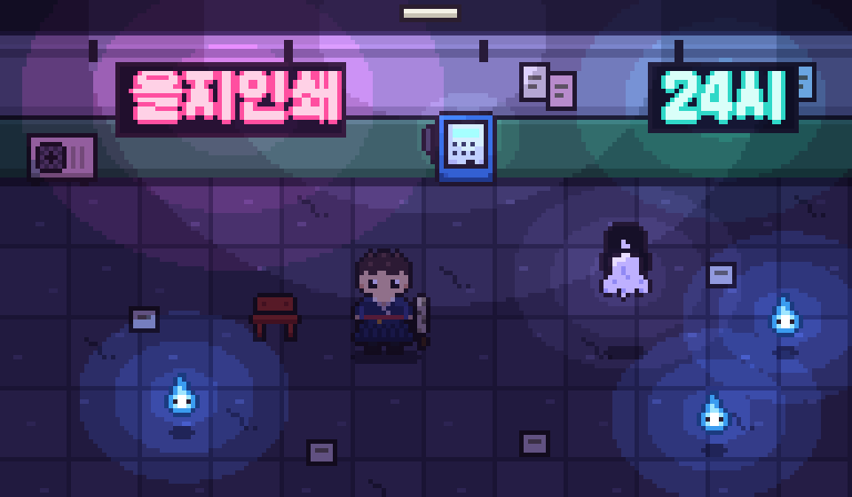

다음: 성별·디자인 확정 → 걷기·휘두르기 프레임 → 게임에 적용.

## 🧪 견본 3차: 직장인 소장 (투잡 설정)
사용자 사양(위 [주인공 모듈](../2-night/protagonist.md#-외형-2026-10-25-사용자-사양--도트용-정리)) 그대로 도트로: 중단발 레이어드, 먹색 라운드넥 숏 자켓 + 검정 터틀넥, 파란 줄 사원증(카드 뒤 노란 부적), 크로스백(끈 대각선) + 노리개, 연베이지 와이드 슬랙스(핀턱 줄), 밝은 운동화.

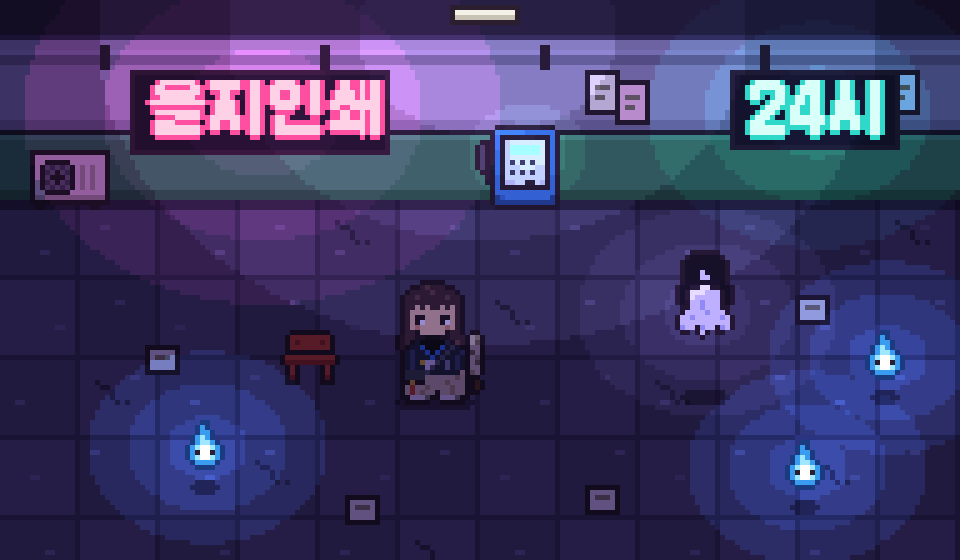

## 🧪 견본 4차: 소울나이트 규칙으로 다시 그림
3차 피드백: 시인성이 낮고, 디테일은 필요 없고, 인물이 안 예쁨. 원인 진단: 밀도보다 설계 문제 — 네모 실루엣, 상체 명암이 외곽선과 뭉침, 8×8 면적에 색 6개, 넓은 얼굴에 떨어진 눈.

소울나이트 스프라이트 3장을 원래 픽셀로 되돌려 잰 규칙(6배 확대 이미지 → 25×25, 38×33, 27×30):
- 순검정에 가까운 1px 외곽선이 전부를 감쌈
- 머리(머리카락 덩어리)가 키의 약 60%, 몸 8~10줄, 다리 2~3줄
- 얼굴 창은 9~12px로 작고 머리카락이 양옆을 두껍게 감쌈
- 눈은 2×2(흰 점 + 진한 색, 아래 홍채색 한 칸), 두 눈 사이 4~5px, 얼굴 아래쪽
- 색은 9~17개, 강조색 하나가 몸을 가로지름(빨간 스카프, 파란 띠)

v4(24×25): 얼굴 10px, 한쪽으로 쓸어 넘긴 앞머리, 쇄골에서 뻗치는 끝, 먹색 자켓은 한 덩어리 + 팔 분리, 강조색은 파란 사원증 줄 하나, 크로스백·노리개·단추는 몸에서 뺌(초상화용), 신문지 칼은 등에 대각선으로 메서 두 번째 실루엣 표시.

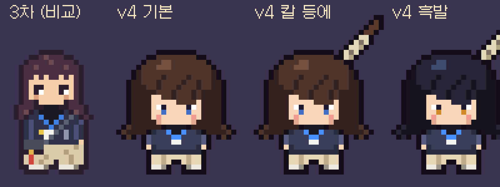

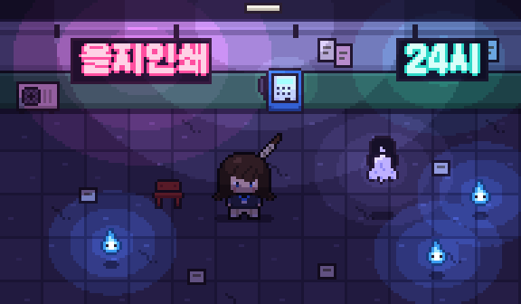

## 🧪 견본 5차: 레퍼런스 4번(소울나이트) 다리·눈·머리 결 반영
4차 피드백: 다리 못생김, 머리가 일자로 내려오다 끝만 뻗침(레이어 아님), 눈 못생김, 턱 아래 그림자가 수염처럼 보임, 칼을 왜 등에.

레퍼런스 4번을 원래 픽셀(27×30)로 되돌려 잰 것: 다리는 몸보다 훨씬 좁고 짧음(한쪽 3px 폭 × 3줄, 사이 1px, 신발 3px × 2줄). 눈은 3~4px 굵은 검은 윗속눈썹 아래 흰자(바깥쪽)+홍채, 두 눈 간격 넓음. 머리는 여러 색 결이 사선으로 흐르고 끝 길이가 제각각.

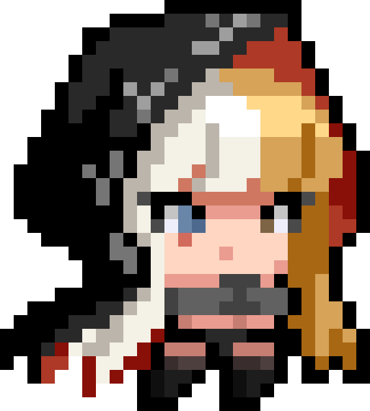

v5(26×27): 위 다리 규칙 그대로, 3px 윗속눈썹 + 3×2 눈(바깥 흰자), 사선 하이라이트 결 + 옆머리 결 줄 + 끝 길이 다르게, 얼굴 아래 그림자 제거(입 1px만), 칼은 손에.

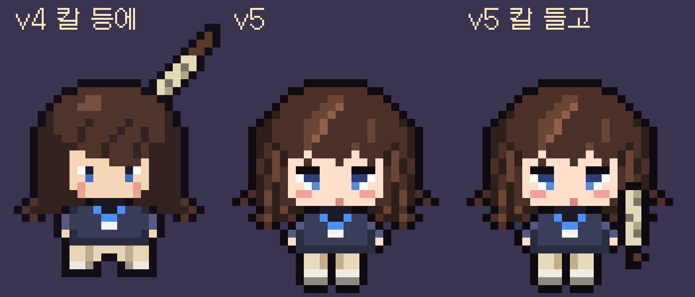

## ✅ 캐릭터 방향 수: 대각선 2장 + 좌우 뒤집기 = 4방향 (2026-10-25 확정)
이동·조준은 8방향 이상이어도 그림은 앞-대각선(↘)과 뒤-대각선(↗) 두 장만 그리고 좌우는 뒤집어 ↙·↖를 만든다. 조준 각도에서 가장 가까운 것을 고른다. 칼은 따로 그려 조준 각도대로 돌리므로 몸 방향은 대충이어도 된다. 장점: 정면 그림보다 실루엣이 좁아 뭉툭하지 않고, 애니메이션 하나당 2장만 그리면 됨. 정면·뒷면·옆면을 따로 그리는 8방향은 작업량이 4배라 이 그림체·1인 개발에 맞지 않음.

## 🧪 견본 6차: 긴 생머리 + 앞-대각선 시점
사용자 사진 레퍼런스: 가슴께까지 오는 매끈한 긴 생머리, 길게 옆으로 넘긴 앞머리. 5차 피드백: 좌우로 두껍고 뭉툭함(소울나이트는 옆을 보는 구도, 우리는 정면). → 앞-대각선(↘)으로 그려 얼굴을 오른쪽으로, 뒤쪽 머리는 왼쪽 어깨 뒤로 길게, 정수리에 윤기 띠.

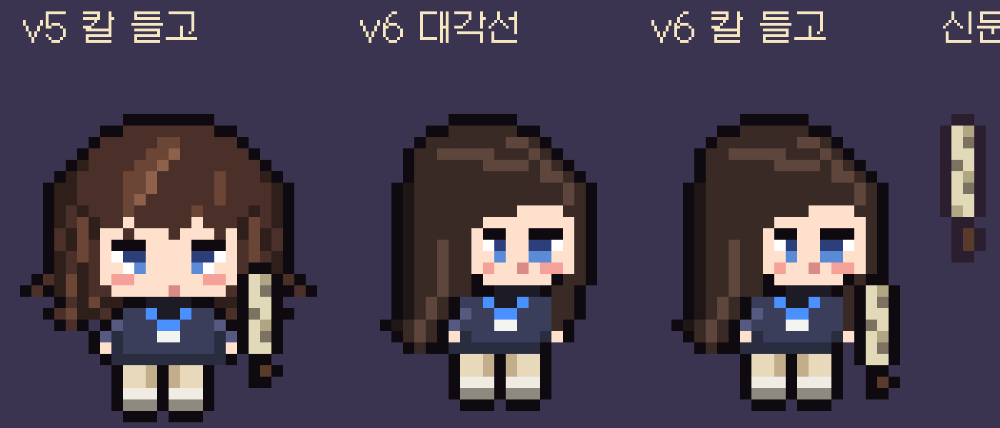
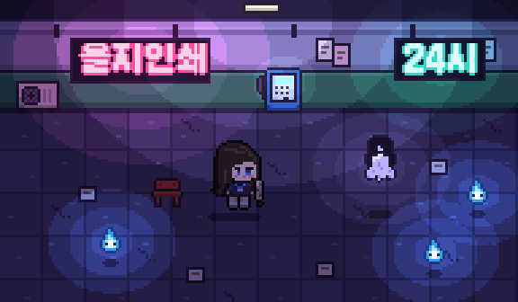

## 🧪 견본 7차: 소울나이트 4번 구조 + 사진 헤어
6차 피드백: 얼굴·몸이 찌그러짐(무리한 3/4 비틀기), 머리가 답답함(사진은 가벼운 앞머리 + 매끈한 긴 생머리), 몸도 별로.
교훈: 소울나이트는 얼굴을 거의 정면으로 두고 몸만 살짝 방향을 준다. 4번처럼 긴 머리가 양옆에서 커튼처럼 내려오고 그 사이로 좁은 몸이 보이는 구조. 앞-대각선 그림도 이 정도의 "거의 정면"으로 그린다.
v7(27×26): 얼굴 거의 정면, 양옆 3칸 머리 커튼(결 줄 포함, 끝 길이 다르게), 밝은 색 가닥의 시스루 앞머리, 정수리 윤기 호, 앞이 열린 칼라 없는 자켓 사이로 검정 터틀넥 + 파란 사원증 줄, 은색 단추 2개, 몸에서 떨어진 소매.

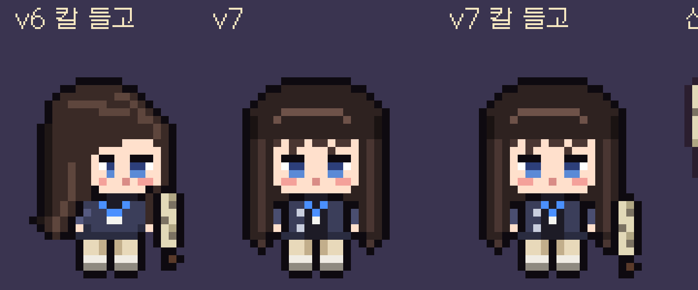

## ➡️ 외부 제작으로 전환 (2026-10-25)
7차 피드백: 몸 방향이 레퍼런스와 다름(4방향인데 정면), 앞머리가 뚜껑 같음, 웨이브·결 없이 일자. 글자 격자 방식의 한계를 인정하고 주인공은 제미나이(또는 외주)로 제작. 명세와 붙여 넣을 프롬프트: [주인공 스프라이트 명세](director-sprite-spec.md). 받은 그림은 우리가 32×32 격자·팔레트로 정리해 게임에 넣는다. 귀신·소품·간판·조명은 지금 방식(`tools/artlab/`)을 계속 쓴다.

## ✅ 게임에 들어간 것 (2026-10-25, 한 층 아트 시험 1차)
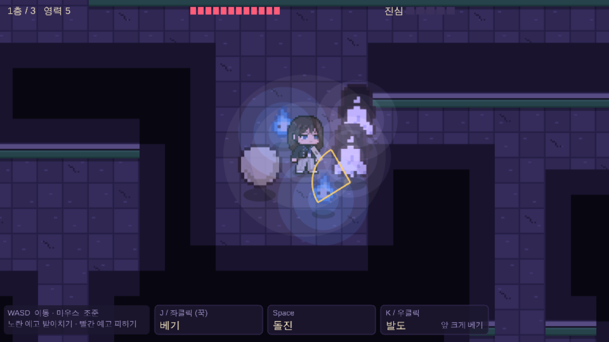

- 주인공: 제미나이 1차를 `tools/spritekit`로 정리한 프레임(`assets/sprites/director-gemini-v1/`). 서 있기·걷기·돌진·피격·뒷모습, 왼쪽은 좌우 반전. 칼은 따로 그려 조준 방향으로 회전. 동작별 프레임 번호는 `src/data/sprites.data.ts`.
- 귀신: 처녀귀신·도깨비불·달걀귀신은 견본 도트(2배 크기, `src/scenes/rift/draw/art/ghostArt.ts`). 지하철 귀신·윤전기 보스는 아직 도형.
- 바닥·벽: 이음새·얼룩·금 간 콘크리트, 회벽 + 초록 방수 페인트 벽(`draw/tiles.ts`, 색은 `feel.data.ts`).
- 밤 조명: 화면 전체를 보랏빛으로 곱하고, 주인공·도깨비불·처녀귀신·계단·공중전화 둘레에 3단으로 끊기는 빛(`FEEL.lights`). 바닥 예고는 조명 위에 그려 어두워지지 않음.
- 그리는 방식: 그림을 같은 색 가로줄로 쪼개 한 그래픽에 찍음(`draw/pixelSprite.ts`) → 귀신·주인공의 앞뒤(아래쪽이 앞) 순서가 그대로 유지됨.

알려진 차이: 주인공(제미나이, 1배 픽셀)과 귀신(견본, 2배 픽셀)의 픽셀 굵기가 달라 나란히 보면 밀도가 다름. 귀신도 제미나이로 같은 밀도로 받거나, 견본 귀신을 더 큰 격자로 다시 그리면 해결.
