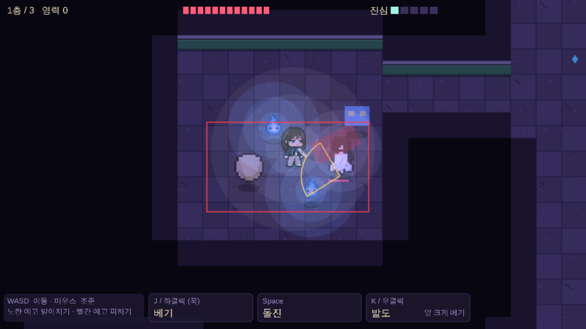

# 🎨 아트·에셋 모듈

**담당 코드:** `src/scenes/rift/draw/`(밤에 그리는 대상별 파일: 주인공 몸 `director.ts`, 칼·휘두름 잔상·발도 효과 `sword.ts`, 귀신, 소품, 타일, 예고), `src/scenes/shared/draw/`(밤·사무소 공용: 도트 찍기 `pixelSprite.ts`, 주인공 프레임 불러오기·조합 `directorFrames.ts`, 공용 도우미 `common.ts`), `src/scenes/hub/HubView.ts`(사무소 실내), `src/data/hubLook.data.ts`(사무소 색), `src/scenes/rift/RiftView.ts`(그리는 순서·밤 조명), `src/data/sprites.data.ts`(주인공 동작별 프레임), `src/data/feel.data.ts`(칸 크기·배율·색·조명·타격감), `src/scenes/shared/vfx.ts`·`sfx.ts`(이펙트·합성 효과음), `assets/`(그림 파일), `tools/spritekit/`(AI 그림 정리 도구), `tools/artlab/`(도트 견본 작업대)

## ✅ 그림체 (확정)
- 소울나이트·러스티의 은퇴 계열의 **큼직한 도트**. 고전 포켓몬처럼 오밀조밀한 도트는 아님.
- 머리 큰 **2등신**, 1px 진한 외곽선, 재질당 2~3색, 흐린 경계·그라데이션 없음.
- 시티팝·밤 분위기는 그림이 아니라 **코드(조명·색)**로 낸다.
- **주인공 1차 시트가 그림체 기준**(`assets/source/gemini/director-sheet-v1.png`). 새 그림은 같은 비율·같은 픽셀 굵기·게임 화면의 어두운 보라 톤이어야 한다.

## ✅ 크기와 방향 (확정)
- 바닥 한 칸 24px, 카메라 1.75배. 주인공(약 37px)은 약 1.5칸, 강적 귀신도 비슷한 키. 판정 범위는 그림보다 조금 작다.
- 데미지 숫자 20px(큰 타격 26, 잡몹 16).
- 캐릭터는 **오른쪽을 보는 그림만** 그리고 왼쪽은 좌우 반전(2방향). 칼과 휘두름 잔상은 따로 그려 조준 방향으로 회전(소울나이트 방식). 위쪽을 향한 공격만 뒷모습 프레임을 쓴다(2026-10-25). 뒷모습 걷기는 아직 없음.

## ✅ 그림 만드는 방법
누가 어떤 도구로 어떤 순서로 만드는지는 [그림 작업 절차](art-pipeline.md)가 기준이다(2026-10-26: 사용자는 찍지 않고 판정만, 프레임은 마스터 한 장을 고쳐서, 기준은 도구가 검사). Gemini에 넣는 문장은 [그림 명세](gemini-asset-specs.md), 주인공 디자인 기록은 [주인공 명세](director-sprite-spec.md).

## ✅ 지금 게임에 들어간 것

| 대상 | 상태 | 위치 |
|------|------|------|
| 주인공 | 🟢 제미나이 그림 + 손질(눈 뜨게, 피격 찡그림: `tools/spritekit/face_edit.py`). 서 있기·걷기·3타 콤보·발도(자세→베기→납도)·위쪽 공격 뒷모습·돌진·피격·쓰러짐 | `assets/sprites/director-gemini-v1`·`v3`, `sprites.data.ts`, `draw/director.ts` |
| 처녀귀신·도깨비불·달걀귀신 | 🧪 제 견본 도트를 2배로(픽셀이 주인공보다 굵음) | `draw/art/ghostArt.ts` |
| 구미호 보스 | 🧪 제가 그린 몹 굵기 도트 1장(꼬리 9개 부채, 2페이즈 분홍 불). 패턴별 자세 없음 | `draw/art/ghostArt.ts`, 생성기 `tools/artlab/gumiho_grid.py` |
| 지하철 망령 | 🧪 임시 도형 | `draw/ghosts.ts` |
| 신문지 칼·휘두름 잔상 | 🧪 칼은 임시 도형, 잔상은 코드(초승달·찌르기) | `draw/sword.ts` |
| 사무소 실내·경리 | 🧪 도형 | `scenes/hub/HubView.ts` |
| 바닥·벽 | 🧪 코드로 그린 콘크리트 + 회벽·초록 페인트 | `draw/tiles.ts` |
| 소품 | 🧪 공중전화만 견본 도트, 계단은 도형 | `draw/props.ts`, `draw/art/propArt.ts` |
| 밤 조명 | 🟢 화면 전체를 보랏빛으로 곱하고, 빛나는 것 둘레에 3단으로 끊기는 빛 | `RiftView.drawLights`, `FEEL.lights` |
| 효과음 | 🧪 합성음 | `scenes/shared/sfx.ts`, `data/sfx.data.ts` |

그리는 방식: 그림을 같은 색 가로줄로 쪼개 한 그래픽에 찍는다(`scenes/shared/draw/pixelSprite.ts`). 그래서 주인공과 귀신의 앞뒤 순서(아래쪽이 앞)가 유지된다. 바닥 예고는 조명 위에 따로 그려 어두워지지 않는다.

## 🤔 남은 것 (Gate 1)
- 제미나이로: 주인공 4차(콤보·뒷모습·얼굴, 명세 0-B), 지하철 망령, 처녀귀신·달걀귀신·도깨비불(주인공과 같은 굵기로), 신문지 칼, 바닥·벽 타일, 소품. 첫 시도(지하철 망령·처녀귀신·칼)는 비율·굵기·색이 따로 놀아서 공통 규칙을 강화함.
- 도구: [그림 작업 절차](art-pipeline.md)의 "아직 없는 도구"(팔레트 강제·검사·비교 이미지·마스터 부품).
- 한글 픽셀 폰트 간판(갈무리, OFL, `tools/artlab/fonts/`)과 소품을 실제 맵에 배치.
- 실제 효과음과 밤 배경음 한 곡.
- 어두운 바닥에서 검정 자켓이 묻히는 문제: 주인공 테두리 빛(코드).

## 1인 개발 에셋 원칙 (유지)
| 원칙 | 줄어드는 작업 |
|------|-------------|
| 귀신은 떠다니는 건 코드, 그림은 몇 장만 | 걷기 애니메이션 거의 0 |
| 색 바꾸기로 변종 | 그림 1장 → 여러 종 |
| 구역당 타일셋 1개, 방은 조립식 | 의뢰마다 새 맵 안 그림 |
| 분위기는 코드 담당 | 그림이 단순해도 됨 |
| 스토리는 대화창 + 초상화 | 컷신 0 |
| 캐릭터 2방향 | 동작마다 1장 |

## 지난 경위 (요약)
견본은 처음에 제가 그림을 글자 격자로 적어 그렸다(`tools/artlab/`). 바닥·조명·간판·귀신·소품 견본은 OK였지만, 주인공은 7차까지 고쳐도 비율·머리·인상이 만족스럽지 않아 폐기하고 제미나이로 전환했다. 제미나이 2차 주인공은 톤이 달라 폐기, 1차가 기준이 되었다. 크기는 칸 16px·2.5배에서 24px·1.75배로 바꿔 몸과 공격 범위를 맞췄다.
