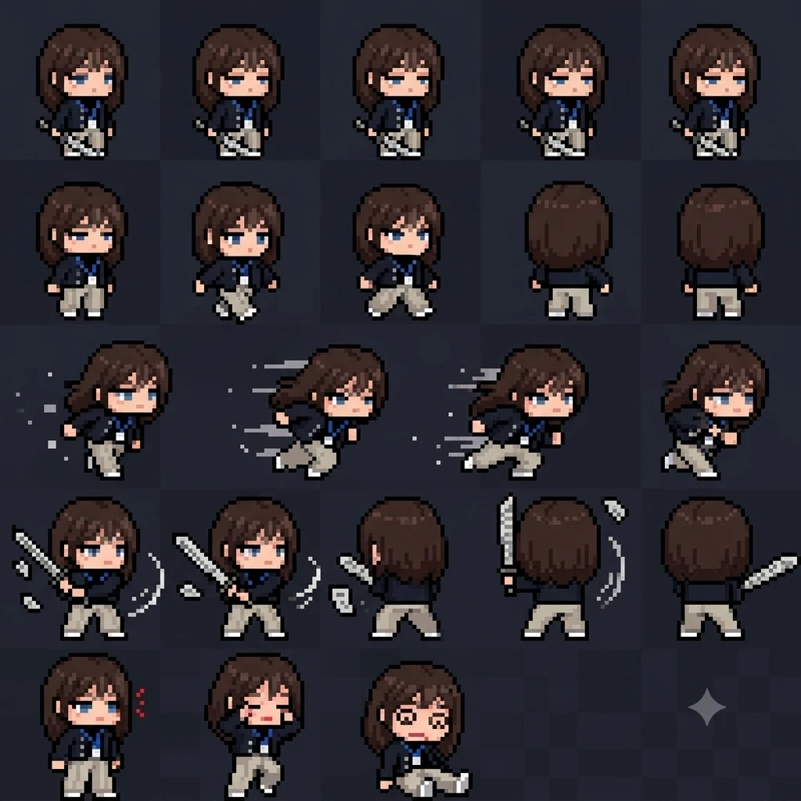
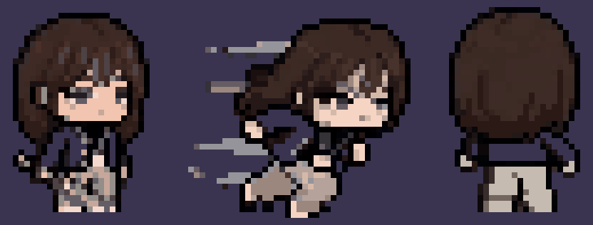
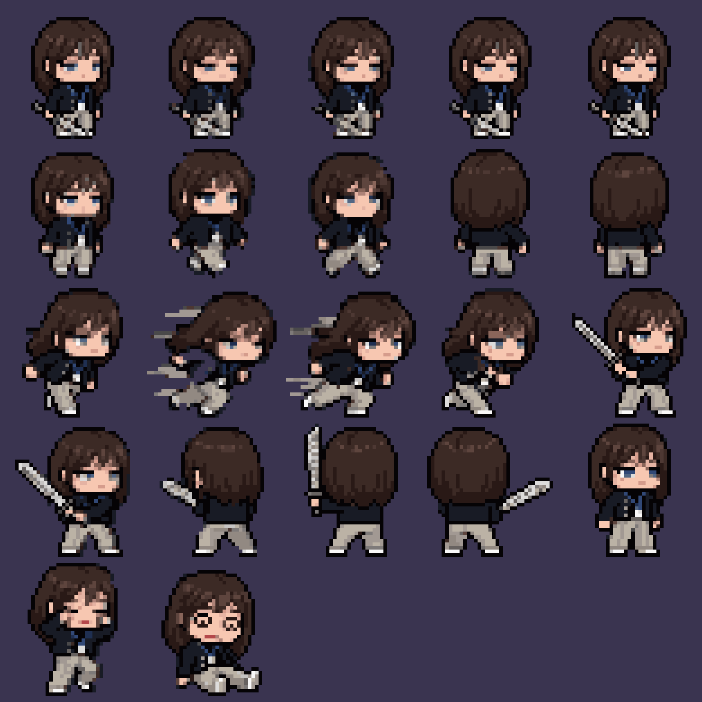
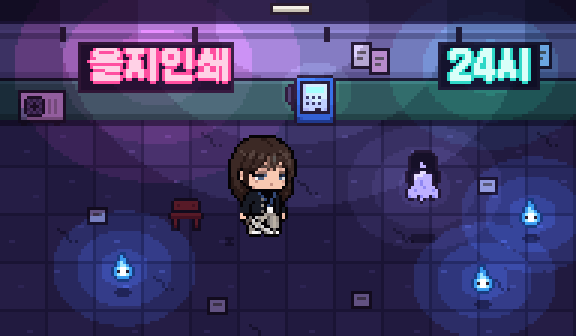
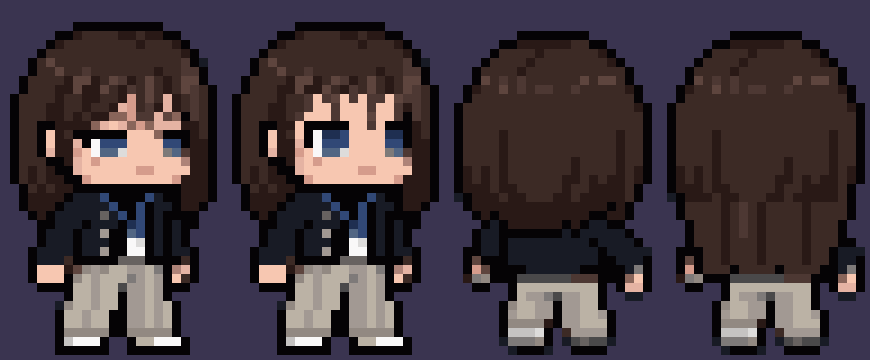

# 🧑‍💼 주인공 스프라이트 명세 (외부 제작용)

← [아트 모듈](art.md) · 2026-10-25. 제미나이 같은 이미지 AI나 외주 작가에게 그대로 넘기는 문서. 받은 그림은 우리 쪽에서 크기·팔레트 규칙에 맞춰 정리한다.

## 1. 함께 첨부할 것
- 소울나이트 레퍼런스 1·3·4번: 그림체, 외곽선, 머리:몸 비율, **몸 방향**의 기준
- 헤어·옷 사진: 머리 스타일과 자켓·터틀넥·슬랙스의 기준
- 우리 게임 밤 장면 견본(`img/artlab-scene-v7s-x3.png`): 배경 위에서 어떻게 보여야 하는지

## 2. 캐릭터
20대 후반 여성 직장인. 낮엔 중소기업, 밤엔 부업으로 퇴마 사무소장. 만성 피로가 밴 무던하고 쿨한 인상, 과장 없는 표정. 이 게임은 서울 배경 어반 판타지이고 톤은 코믹하다(은혼 계열).

## 3. 그림체 규칙
- 큼직한 도트 픽셀아트(소울나이트 계열). 안티에일리어싱·그라데이션·흐린 경계 없음.
- 모든 외곽은 거의 검정(#0e0a10)인 1px 선.
- 2등신 SD: 머리(머리카락 포함)가 키의 약 55~60%.
- 캐릭터 키 약 26~28px, 한 프레임 캔버스 32×32px, 발은 아래에서 2px 위(y=30)에 맞춤. 배경 투명.
- 색은 전체 24개 이하. 재질당 2~3단계 명암, 빛은 왼쪽 위.
- 밤의 어두운 보라 배경에서 읽혀야 함: 머리·자켓이 외곽선과 같은 검정으로 뭉치지 않게 한 단계 밝게.

## 4. 머리 (가장 중요)
- 가슴께까지 오는 긴 생머리, 흑갈색(#2e2220 바탕, 어두운 결 #1a1312, 밝은 결 #4a3632, 윤기 #6e5249).
- **앞머리는 가벼운 시스루**: 이마를 덮는 뚜껑이 아니라 가는 가닥 몇 개 사이로 이마가 비침. 양옆으로 얼굴선을 따라 떨어지는 긴 옆머리.
- 아래로 갈수록 **미세한 웨이브와 결**: 일자로 쭉 떨어지지 않게 가닥마다 살짝 휘고, 끝은 길이가 제각각으로 가볍게 흩어짐.
- 정수리에 매끈한 윤기 하이라이트(호 모양).

## 5. 얼굴
- 작은 얼굴, 피부 #ffe0cc, 볼터치 #f4a19a.
- 눈: 굵은 검은 윗속눈썹, 그 아래 흰자와 파란 홍채(#2d3f7a / #5b8ad6), 살짝 내리깐 무던한 눈매.
- 입은 1px 정도. 턱 아래 어두운 그림자 금지(수염처럼 보임).

## 6. 옷과 소품
- 칼라 없는 라운드넥 검정 트위드 숏 자켓(밤 배경용으로 아주 어두운 남색 #3b3e5a 쪽), 앞이 열려 있고 한쪽 앞섶에 은색 단추 2~3개.
- 안에 검정 터틀넥(#1d1b26).
- 바지: 연베이지 핀턱 와이드 슬랙스(#e8d9ba / 그림자 #c2ae8b), 발등 위로 떨어짐.
- 밝은 운동화.
- 목에 파란 줄 사원증(줄 #4a90ff, 흰 카드). 크로스백·노리개·부적은 몸 스프라이트에서 뺀다(대화 초상화에서 살림).
- 무기(신문지로 싼 칼)는 **그리지 않는다**. 게임이 따로 그려서 조준 방향으로 돌린다. 손은 비워 둔다.

## 7. 방향 (4방향)
그리는 것은 2방향, 나머지 2방향은 우리가 좌우 반전해서 만든다.
- **앞-대각선(↘, 화면 오른쪽 아래를 봄)**: 소울나이트 레퍼런스처럼 얼굴이 3/4로 오른쪽을 향하고, 가까운 쪽 눈이 크게, 먼 쪽 눈은 일부 보임. 몸도 같은 쪽으로 틀어져 가까운 어깨가 앞으로. 머리카락은 먼 쪽(왼쪽)이 어깨 뒤로, 가까운 쪽이 어깨 앞으로 떨어짐. **정면 그림이 아님.**
- **뒤-대각선(↗, 화면 오른쪽 위를 봄)**: 같은 각도에서 뒤통수와 등이 보임. 긴 머리가 등을 덮고, 얼굴은 볼 선만 살짝.

## 8. 필요한 프레임 (방향마다)
| 동작 | 프레임 | 설명 |
|------|-------|------|
| 서 있기 | 2 | 숨쉬기: 몸이 1px 오르내림, 머리끝이 살짝 흔들림 |
| 걷기 | 4 | 다리 교차, 머리카락이 걸음에 따라 흔들림 |
| 돌진 | 1 | 몸을 앞으로 숙이고 머리카락이 뒤로 날림 |
| 베기 자세 | 2 | 팔을 앞으로 뻗은 자세(칼은 없이) |
| 피격 | 1 | 움찔하며 뒤로 젖힘 |

방향 2개 × 10프레임 = 20프레임. 한 줄에 한 동작씩, 32×32 칸을 붙인 시트 한 장(가로 4칸 × 세로 10줄)으로.

## 9. 받은 뒤 우리가 하는 일
1. 그림을 정확한 32×32 격자로 줄이고(가장 가까운 픽셀), 위 팔레트로 색을 맞추고, 배경을 지운다.
2. 반전해서 4방향을 만들고 `src/scenes/rift/draw/director.ts`에 연결한다.
3. 실제 게임 배율(약 2.5배)과 밤 조명 아래에서 읽히는지 확인한다.

## 10. 붙여 넣을 프롬프트 (영문, 제미나이용)

```
Pixel art game sprite sheet, Soul Knight style chunky pixels, transparent background.
Character: a tired, cool office worker woman in her late 20s who is a part-time exorcist at night (urban fantasy Seoul, comedic tone).
Style rules: 1px near-black outline (#0e0a10) around everything, no anti-aliasing, no gradients, max 24 colors, 2-3 shades per material, light from top-left. Chibi proportions: head with hair is about 55-60% of the height. Character about 27px tall inside a 32x32 frame, feet at y=30.
Hair (most important): long straight dark brown hair down to the chest (#2e2220, darker strands #1a1312, lighter strands #4a3632, glossy highlight arc on the crown #6e5249). Light see-through wispy bangs (a few thin strands, forehead visible, NOT a solid helmet of bangs), long face-framing side locks, subtle gentle waves and separate strands toward the ends, ends of uneven length.
Face: small face (#ffe0cc), blush (#f4a19a), thick black upper eyelashes, blue eyes (#2d3f7a / #5b8ad6), slightly lowered calm gaze, tiny mouth, no dark shading under the chin.
Outfit: collarless round-neck cropped tweed jacket in very dark navy (#3b3e5a), worn open, 2-3 silver buttons on one front edge; black turtleneck (#1d1b26) underneath; light beige pin-tuck wide slacks (#e8d9ba, shadow #c2ae8b) falling over the shoes; light sneakers; blue lanyard (#4a90ff) with a white ID card on the chest. Hands empty (the weapon is drawn separately by the game).
Directions: draw only two facings. (1) 3/4 front view facing down-right like the Soul Knight references: face turned to the right, near eye larger, far eye partly visible, body turned the same way with the near shoulder forward, far-side hair behind the shoulder and near-side hair in front. This is NOT a straight front view. (2) 3/4 back view facing up-right from the same angle: back of the head and long hair covering the back.
Frames per direction, one animation per row, 32x32 cells: idle 2 (1px breathing, hair tips sway), walk 4 (legs alternate, hair swings), dash 1 (leaning forward, hair blown back), attack pose 2 (arm extended forward, no weapon), hurt 1 (flinch back).
Output: one sprite sheet, 4 columns x 10 rows of 32x32 cells, each pixel a crisp square block aligned to the grid.
```

같이 붙일 것: 소울나이트 레퍼런스 1·3·4번, 헤어·옷 사진, 밤 장면 견본.

## 11. 1차 결과 검토 (제미나이, 2026-10-25)




살릴 것: 머리색·옷 조합·사원증·얼굴 인상이 우리 의도대로 읽힘. 돌진 프레임의 비스듬한 옆 시점이 가장 좋음 → 앞-대각선은 이 각도로.

고칠 것:
- 명세 위반: 칼·칼날 궤적·속도선·별 같은 효과가 그려짐(게임이 따로 그림), 칸 배치가 5열로 섞이고 동작 수가 다름.
- 배경이 투명이 아니라 어두운 체크무늬로 칠해짐. 검정 자켓과 색이 거의 같아서 배경을 지우면 몸까지 같이 지워짐(정리 시험에서 자켓이 사라짐).
- 픽셀 격자가 맞지 않음: 한 픽셀이 4~5px로 들쭉날쭉하고, 한 칸 안 색이 5천 개 넘음(흐린 경계·압축 잡티). 원래 크기로 줄이면 얼룩이 생김. 캐릭터 키도 명세(27px)보다 큰 약 35px.
- 시점: 서 있기·걷기는 여전히 정면, 뒷모습은 완전 뒤. 3/4는 돌진 프레임뿐.
- 머리: 앞머리가 여전히 무거운 덩어리, 길이가 어깨 정도(명세는 가슴께), 뒷모습은 짧은 단발 버섯 모양이라 앞모습과 안 맞음.
- 프레임마다 머리 크기·얼굴이 조금씩 다름(모델 일관성).
- 눈이 너무 졸림.

## 12. 2차 요청 프롬프트 (1차에 덧붙여 보내기)

```
Revise the sprite sheet with these fixes:
1. Background: one flat solid color #FF00FF (magenta) everywhere, no checkerboard, no texture. Everything that is not magenta is the character.
2. Strict pixel grid: the art must be exactly 32x32 pixels per frame, then upscaled by exactly 8x with nearest neighbor (each art pixel = one 8x8 block). No anti-aliasing, no blur, no noise. Max 24 colors.
3. No weapon, no slash arcs, no speed lines, no particles, no stars. Character only.
4. Layout: exactly 4 columns x 10 rows, one animation per row, empty cells left magenta.
   Rows 1-5 = facing down-right, rows 6-10 = facing up-right.
   Each block of 5 rows: idle(2), walk(4), dash(1), attack pose(2), hurt(1).
5. Angle: use the same 3/4 side angle as the dash frames for every down-right frame (body and face turned to the right). Up-right frames: the same angle from behind, the cheek line barely visible.
6. Hair: long straight hair reaching the chest in ALL frames including the back view (back view shows long hair covering the back, not a short bob). Light see-through bangs made of a few thin strands with the forehead visible. Gentle waves near the ends.
7. Eyes: normal open eyes with a calm look and faint dark circles, not sleepy.
8. Keep the same head size and face in every frame (on-model).
```

## 13. 1차 결과 정리 (우리 쪽)
`tools/spritekit/clean_sheet.py`로 정리: 픽셀 크기 5.1px를 찾아 원래 격자(약 40px 칸, 캐릭터 키 약 35px)로 되돌리고, 배경을 지우고, 22프레임을 24색 공용 팔레트로 맞춤. 결과는 `assets/sprites/director-gemini-v1/`.




바로 쓸 수 있는 프레임(번호 정정): 서 있기 19번, 걷기 5·6·7번, 달리기 10·13번, 뒷모습 8·9번, 피격 20번, 쓰러짐 21번. 0~4번은 다리 앞에 칼이 겹침, 11·12번은 속도선, 14~18번은 칼이 박혀 있어 제외.

## 14. 손질 (우리 쪽, `tools/spritekit/edit_frame.py`)
왼쪽부터 서 있기 원본 → 손질, 뒷모습 원본 → 손질.



- 눈: 굵은 속눈썹이 눈 윗줄을 덮어 2줄만 보이던 것(졸린 인상)을 한 줄 올려 3줄로 엶.
- 앞머리: 이마를 덮던 덩어리를 한 톤 밝은 가는 가닥 4~5개로 바꾸고 사이로 이마가 비치게.
- 뒷모습: 어깨 위에서 끊기던 단발을 등 위로 5줄 늘리고 결 줄과 제각각인 끝으로 긴 생머리에 맞춤.
손질본은 `frame_19_edit.png`, `frame_08_edit.png`. 나머지 프레임(걷기·달리기·뒷모습 2·피격·쓰러짐)에도 같은 손질 예정.
